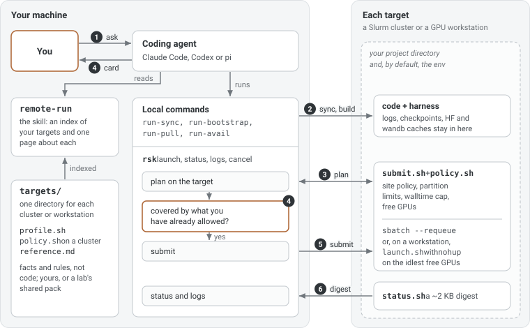

[Run-Skills](https://github.com/NAIVlab/run-skills) takes a coding agent's training script the last mile, onto a Slurm cluster or a GPU workstation. It is one skill, `remote-run`, plus a small bash harness and a command, `rsk`; one installed copy serves Claude Code, Codex and pi. Left alone, agents write `sbatch` scripts with the wrong memory flags, fill `$HOME` with caches, launch onto a GPU someone else is using, or "fix" a stuck job by cancelling it. Run-Skills gives them a few commands with the guard rails built in.

<figure>
  
</figure>

The skill is what the agent reads: an index of your targets and one page about each, so it reads little and guesses nothing. The harness is what it runs on your machine, and the scripts that do the remote work are deployed next to each project along with the code. A cluster or workstation is one directory of facts and rules (`profile.sh` and `reference.md`, plus `policy.sh` for a cluster), not code, so adding one means writing that directory, and a lab can share its targets as a private pack.

One run, as numbered in the figure:

1. You ask in plain words: "train this on the cluster, 2 GPUs, one day."
2. `run-sync` copies the code and deploys the harness next to it, without touching data, logs or checkpoints. `run-bootstrap` builds the environment there: a uv venv, or a check that a named conda env exists.
3. `rsk launch` plans the job on the target. The site's policy, the partition's limits, the walltime cap and free GPUs are all checked, and nothing is submitted.
4. rsk checks the plan against what you have already allowed: a plan you approved, a sweep, or a standing permission such as "smoke runs on this box are fine". If nothing covers it, the agent shows you the plan card and waits for your go.
5. The job goes out with `sbatch --requeue` on a cluster, or with `nohup` on the idlest free GPUs of a workstation.
6. `rsk logs` reads a digest of about 2 KB from `status.sh`: the job's state, how it exited, counts of errors, OOMs and NaNs, the wandb link and the last lines of the log; `rsk status` lists every run of the project. Stopping a run stays your call, and `run-pull` copies the results back.

Where code can enforce a rule, the harness does:

- **Contained.** Logs, checkpoints, wandb and the HuggingFace and torch caches stay under the project. The environment goes where the target's storage policy says, by default the project too.
- **Fails closed.** A broken config or a missing environment stops a job before it runs. A walltime above the partition's cap, or no limit at all, is refused instead of left to pend forever.
- **Hands off other people's work.** A workstation run never takes a GPU another job is using unless you say so, and a cancel first checks that the job belongs to this project and to you.
- **Tested offline.** `selftest.sh` runs the harness against stubbed `sbatch`, `squeue`, `ssh`, `uv` and `rsync`, so nothing leaves your machine.
