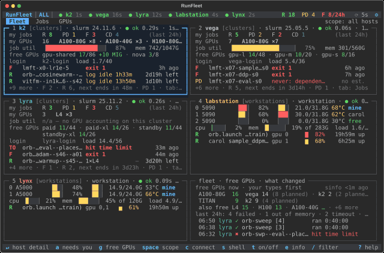

<figure>
  
</figure>

[RunFleet](https://github.com/Yuanpeng-Li/runfleet) does the rounds of `squeue`, `sacct`, `nvidia-smi` and `tail -f` for you. It polls each host over your own SSH setup and shows, in one keyboard-driven view, what is running, what is waiting and why, which GPUs are busy or idle, and what went wrong with the jobs that ended.

- **Every host at a glance:** your running, pending and failed jobs, the GPUs you hold, free GPUs per partition and the next job in line.
- **Live GPU readings inside a job:** per-GPU utilisation and memory read on the job's own node, which catches a GPU sitting idle that the job's average hides.
- **Why jobs end and wait:** ended jobs get a cause (`OOM-GPU`, `NCCL`, `TIMEOUT`, …) linked to the log line, and pending jobs show the priority factors that hold them back.

The [RunFleet site](/runfleet/) has an interactive demo that runs in the browser, and install instructions.

Its companion, [Run-Skills](/projects/run-skills/), lets a coding agent launch those jobs.
